# How the EMIS Census app works, explained simply

This guide explains the whole app in plain words: what each part does, who can do what, and what
happens behind the screen when someone clicks a button. Every example is real: it was recorded
from the running app on 28 October 2026, following one school's census from start to finish.

You do not need to be a programmer to follow the story. If you are one, each step also names the
exact file and function, and shows the data that travels between them.

**Contents**

1. [The idea in one minute](#1-the-idea-in-one-minute)
2. [The parts of the app](#2-the-parts-of-the-app)
3. [Words used in this guide](#3-words-used-in-this-guide)
4. [How to read the diagrams](#4-how-to-read-the-diagrams)
5. [Data flow diagrams (DFDs)](#5-data-flow-diagrams-dfds)
6. [The people in the demo](#6-the-people-in-the-demo)
7. [How the code is organised](#7-how-the-code-is-organised)
8. [How one click travels through the app](#8-how-one-click-travels-through-the-app)
9. [What happens when the app starts](#9-what-happens-when-the-app-starts)
10. [Story 1: Alicia logs in](#10-story-1-alicia-logs-in)
11. [Story 2: Alicia fills in the census form](#11-story-2-alicia-fills-in-the-census-form)
12. [Story 3: The return is reviewed and frozen](#12-story-3-the-return-is-reviewed-and-frozen)
13. [Story 4: The numbers reach Brenda's dashboard](#13-story-4-the-numbers-reach-brendas-dashboard)
14. [Story 5: Kendell defines a new KPI, field and form](#14-story-5-kendell-defines-a-new-kpi-field-and-form)
15. [Story 6: Kendell builds and publishes a dashboard](#15-story-6-kendell-builds-and-publishes-a-dashboard)
16. [Refreshing dashboards](#16-refreshing-dashboards)
17. [Switching account, signing out and timing out](#17-switching-account-signing-out-and-timing-out)
18. [Who may do what, and how the app decides](#18-who-may-do-what-and-how-the-app-decides)
19. [Logs: tracing what happened](#19-logs-tracing-what-happened)
20. [When something goes wrong](#20-when-something-goes-wrong)
21. [Quick reference](#21-quick-reference)

---

## 1. The idea in one minute

Every year, each school reports a few figures to the Ministry of Education: how many pupils, how
many teachers, how many of those teachers are trained. This is the **school census**.

On paper, it would work like this:

1. The school's **registrar** fills in the census form.
2. The **principal** checks it and signs it.
3. The **District Education Officer (DEO)** checks it for the whole district.
4. An analyst at the ministry's **Corporate Planning Unit (CPU)** checks it one last time and
   stamps it **final** ("frozen").
5. Only final figures go onto the ministry's wall charts. Those charts show things like "the share
   of trained teachers" (a **KPI**, a key performance indicator).

If someone finds a mistake, they hand the form back one step, with a note saying what is wrong.

This app does exactly that on screen:

- **Forms:** the CPU analyst designs the forms and decides which figures (KPIs) the ministry
  tracks, and which schools must report them.
- **Charts:** charts come from **Apache Superset**, a chart tool, shown inside the app.
- **Who sees what:** each person sees only what they are allowed to see. The Minister sees the
  whole country, a DEO their district, a principal their school, and a teacher nothing.

---

## 2. The parts of the app

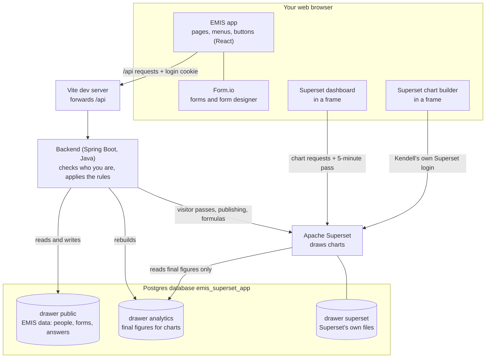


Think of it as an office:

| Part | Office comparison | What it really is |
|------|-------------------|-------------------|
| **The EMIS app** (frontend) | The front desk and its screens | A React web app in `frontend/`. It shows pages and sends requests. It never touches the database itself |
| **The backend** | The clerk behind the desk, who checks your ID card and keeps the files | A Java Spring Boot program in `backend/`. Every rule is checked here |
| **The database** | A filing cabinet with three locked drawers, each with its own key | Postgres, database `emis_superset_app`, with three schemas (drawers): `public`, `analytics`, `superset` |
| **Superset** | The print shop that turns figures into charts | Apache Superset 6.1, run on this machine (`superset/local/start.sh`), at `localhost:8088` |
| **Form.io** | A form-design kit and a form-filling kit | A JavaScript library used inside the app's pages |

**Why three drawers?** Superset holds the key to the `analytics` drawer only, and that drawer
holds only *final* figures. So Superset can never see drafts, people's passwords, or anything else
in `public`.

---

## 3. Words used in this guide

| Word | Meaning |
|------|---------|
| **KPI** | A figure the ministry tracks, e.g. "Trained teacher %". It is calculated from fields |
| **Field** | One piece of information a form asks for, e.g. `total_teachers`. One field can feed many KPIs |
| **Numerator / denominator** | The top and bottom of a fraction. "Trained teacher %" = trained teachers (top) ÷ all teachers (bottom) × 100 |
| **Form** | A questionnaire built from fields, e.g. the Annual School Census |
| **Return** | One school's filled-in form for one year, e.g. "School A's census for 2026/2027" |
| **Status** | Where a return is: Draft → With principal → With DEO → With CPU analyst → Frozen |
| **Frozen** | Final. Only frozen returns count in charts |
| **Scope** | Which schools must report a KPI (by school type, district, or hand-picked schools; empty means all) |
| **Role** | A job: Minister, CPU analyst, DEO, principal, registrar, teacher |
| **Capability** | Something a role may do: view dashboards, build charts, manage KPIs, fill forms, review |
| **Request / response** | A message from the app to the backend, and its answer |
| **API / endpoint** | An address the backend answers, like `/api/returns/mine`, a bit like a counter window with a name |
| **JSON** | The text format requests and answers are written in, e.g. `{"status": "DRAFT"}` |
| **Session cookie** | A ticket the browser keeps after you log in (`JSESSIONID`). It is shown with every request, so you don't log in again each time |
| **Guest token ("visitor pass")** | A signed, 5-minute pass that lets the browser load one Superset dashboard, with a row filter written inside it |
| **Row filter (RLS, row-level security)** | A rule Superset adds to every question it asks the database, e.g. "only School A". Nobody can remove it, because it is inside the signed pass |
| **Embedding** | Showing a Superset dashboard inside the EMIS page, in a frame |
| **Controller / service / client** | Kinds of backend classes: the receptionist, the specialist, and the phone line to another company (see section 7) |

---

## 4. How to read the diagrams

The pictures in this guide are drawn with Mermaid. GitHub and most Markdown viewers turn them into
diagrams automatically.

| Picture | What it shows | How to read it |
|---------|---------------|----------------|
| **Flowchart** | Parts, or decisions | Boxes are parts or questions; arrows show what goes where, labelled with what travels |
| **Data flow diagram (DFD)** | Where information comes from, what handles it, and where it is kept | See the symbols below |
| **Sequence diagram** | One action, step by step, in time order | The people and parts stand along the top. Read the arrows from top to bottom: a solid arrow is a request, a dashed arrow is the answer. The numbers give the order |
| **State diagram** | The stages something goes through | Each box is a stage; an arrow shows what moves it to the next one |
| **Entity–relationship diagram** | How the database tables link | Lines join related tables; the line ends show "one" (two short bars) or "many" (a crow's foot) |

The symbols used in the data flow diagrams:

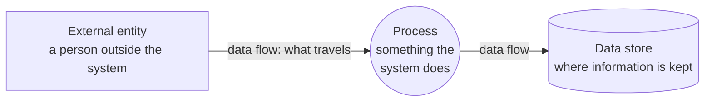

---

## 5. Data flow diagrams (DFDs)

A data flow diagram follows **information**, not code. It answers three questions: where does the
information come from, what happens to it, and where is it kept? There are three levels: the whole
system as one bubble, then its main jobs, then the details of two of those jobs.

### Level 0: the whole system and the people around it

Every person gives the system something and gets something back. The system is one bubble here.

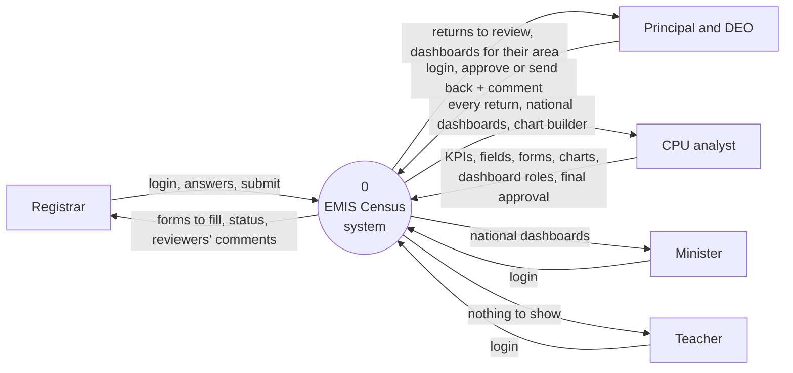

### Level 1: the seven main jobs and the seven places data is kept

Opening the bubble shows seven processes (circles) and seven data stores (cylinders). Before any
other process does its work, it asks process 1.0 who you are.

| Store | Holds | Tables |
|-------|-------|--------|
| D1 | People, accounts, roles, schools | `person`, `account`, `school_role`, `school`, `district` |
| D2 | KPIs, fields, forms | `kpi`, `kpi_field`, `field`, `form`, `form_kpi` |
| D3 | Returns and answers | `form_return`, `form_return_value` |
| D4 | Review history | `form_return_event` |
| D5 | Final figures | the view `analytics.census_frozen` |
| D6 | Dashboard publications | `dashboard_publication` |
| D7 | Superset's charts and dashboards | the `superset` drawer |

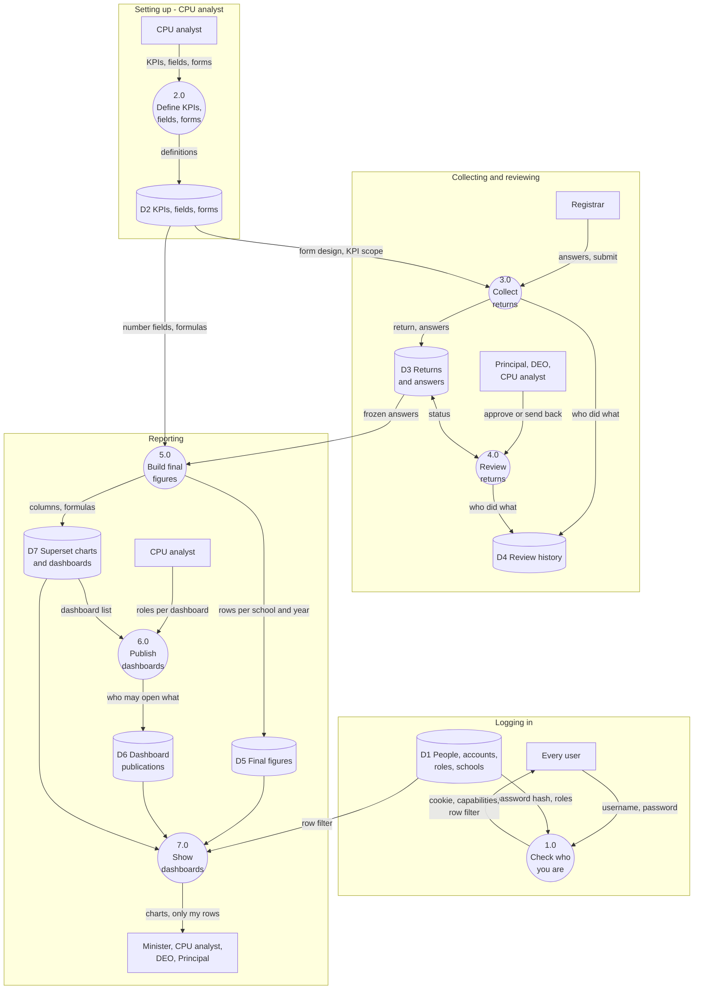

| Process | Done by (backend) | Story |
|---------|-------------------|-------|
| 1.0 Check who you are | `AuthController`, `AccessService`, `UserSession` | [Story 1](#10-story-1-alicia-logs-in) |
| 2.0 Define KPIs, fields, forms | `AdminController`, `KpiService`, `FieldService`, `FormService` | [Story 5](#14-story-5-kendell-defines-a-new-kpi-field-and-form) |
| 3.0 Collect returns | `ReturnController`, `ReturnService`, `FormService` | [Story 2](#11-story-2-alicia-fills-in-the-census-form) |
| 4.0 Review returns | `ReturnController`, `ReturnService` | [Story 3](#12-story-3-the-return-is-reviewed-and-frozen) |
| 5.0 Build final figures | `AnalyticsViewService`, `SupersetClient` | [Story 4](#13-story-4-the-numbers-reach-brendas-dashboard) |
| 6.0 Publish dashboards | `AdminController`, `DashboardService`, `SupersetClient` | [Story 6](#15-story-6-kendell-builds-and-publishes-a-dashboard) |
| 7.0 Show dashboards | `AnalyticsController`, `DashboardService`, `SupersetClient`, Superset | [Story 4](#13-story-4-the-numbers-reach-brendas-dashboard) |

### Level 2: collecting returns (process 3.0)

How a registrar's answers become a return. Each small process names the function that does it,
and the numbers on the registrar's arrows give the order. The registrar is drawn twice (a usual
DFD habit): at the top as the one who acts, at the bottom as the one who sees the result.

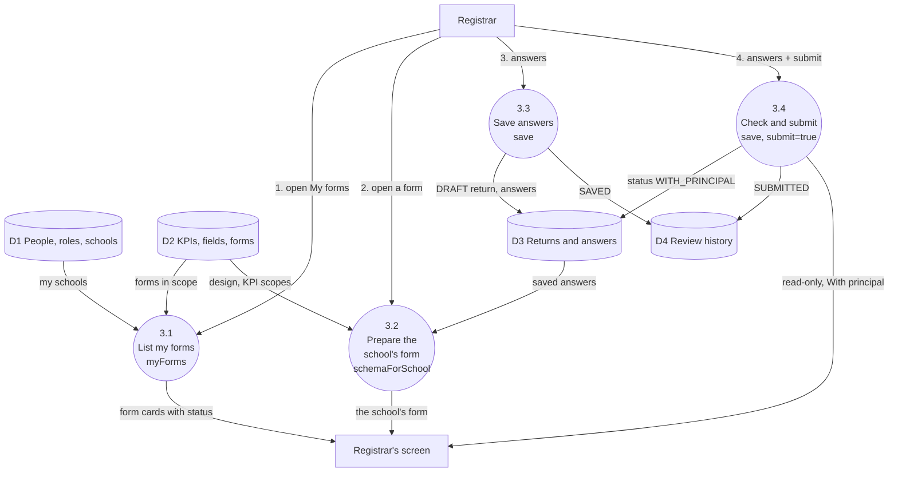

### Level 2: reviewing returns (process 4.0)

How a return climbs the review ladder, one step at a time. The reviewer is drawn twice, as above.

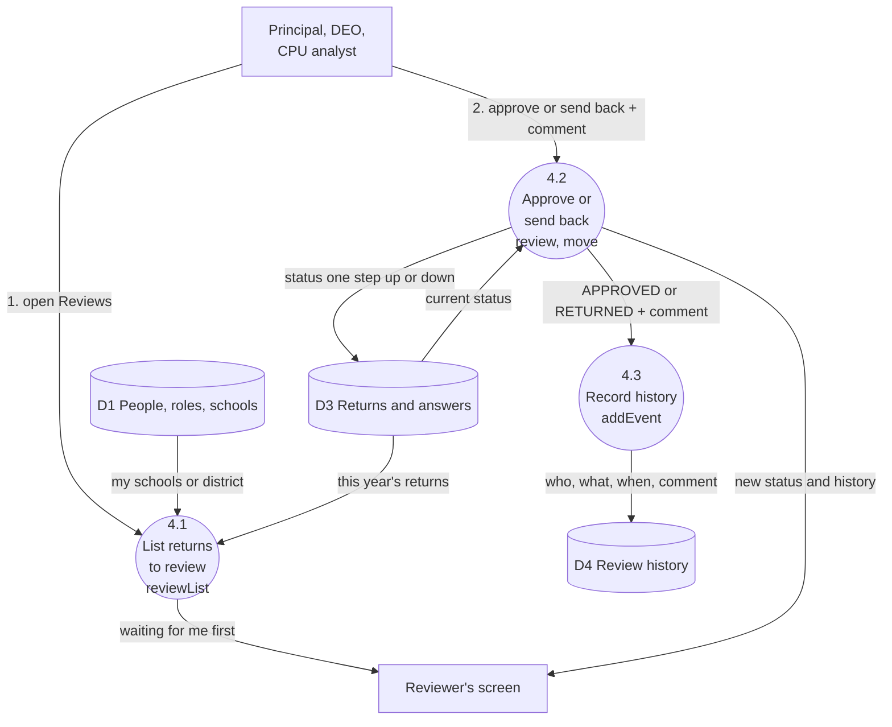

### Level 2: showing a dashboard (process 7.0)

How a person gets charts that contain only their own rows.

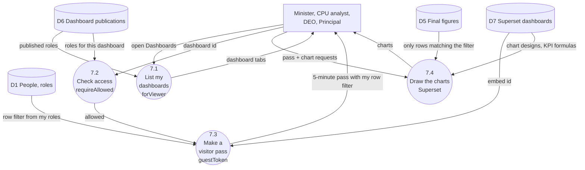

---

## 6. The people in the demo

Every account's password is `Census#2026`. You can also switch between them with the dropdown at
the top right after logging in.

| Who | Username | Role | Sees in the menu | Data they see |
|-----|----------|------|------------------|---------------|
| Hon. Grace Laurent | `glaurent` | Minister of Education | Dashboards | The whole country |
| Kendell St. Rose | `kstrose` | CPU analyst | Dashboards, Chart builder, Reviews, KPI registry, Field library, Form builder, Dashboard access | The whole country |
| Marcia Felix | `mfelix` | DEO of District D03 | Dashboards, Reviews | D03 only |
| Patricia Williams | `pwilliams` | DEO of District D02 | Dashboards, Reviews | D02 only |
| Brenda Francis | `bfrancis` | Principal, Sample Primary School A (D03) | Dashboards, Reviews | School A only |
| Martin Joseph | `mjoseph` | Principal, Sample Primary School B (D02) | Dashboards, Reviews | School B only |
| Alicia Thomas | `athomas` | Registrar, School A | My forms | — |
| Natalie Charles | `ncharles` | Registrar, School B | My forms | — |
| Kevin Pierre, Lisa Mathurin, Dwayne Henry, Sasha Edwards | `kpierre`, `lmathurin`, `dhenry`, `sedwards` | Teachers | Nothing ("Nothing to show for your role") | — |

The stories below follow **Sample Primary School A** in District D03, through Alicia, Brenda,
Marcia and Kendell.

---

## 7. How the code is organised

### The backend (`backend/src/main/java/com/emis/analytics/`)

The backend is split into folders by job, like departments in an office:

```
com/emis/analytics/
├── EmisAnalyticsApplication.java   the "on" switch: starts everything
├── controller/   RECEPTIONISTS: take a request, check who is asking, pass it on, send the answer
│     AuthController       log in, log out, "who am I", activity, switch account
│     AnalyticsController  KPI list, dashboards, visitor passes, chart-builder links
│     AdminController      KPI registry, field library, forms, dashboard access (CPU analyst only)
│     ReturnController     my forms, reviews, approve / send back
├── service/      SPECIALISTS: the rules of the app and the database work
│     AccessService        who you are, your roles, what you may do, your row filter
│     UserSession          remembers who is logged in; logs you out when idle
│     KpiService           KPIs, their scope and formulas
│     FieldService         the field library
│     FormService          forms, and each school's version of a form
│     ReturnService        returns, answers, and the review chain with its history
│     DashboardService     which roles may open which dashboard
│     AnalyticsViewService rebuilds the "final figures" table and tells Superset
│     SsoTokenService      makes the one-minute ticket that signs Kendell in to Superset
├── logging/      THE LOGBOOK: notes down every request and every step (section 19)
│     RequestLoggingFilter the first stop of every request: request id, user, endpoint, status, call trace
│     CallTraceConfig      tells Spring to wrap every controller, service and client method …
│     CallTraceInterceptor … with ▶ (start) and ◀ (finish) log lines, indented by depth
│     CallTrace            remembers the depth and the calls of the current request
│     LogSafety            hides passwords, tokens and hashes in log lines
│     StartupReport        after start-up: what ran and what didn't (✔ / ⚠ / ✘)
├── client/       PHONE LINE to another system
│     SupersetClient       every call to Superset (visitor passes, dashboards, formulas)
│     SupersetLogin        what one Superset login gives back (used only by SupersetClient)
├── config/       SETTINGS
│     SupersetProperties   Superset's addresses, login and secrets, from application.yml
│     CorsConfig           which other websites may call the backend
├── model/        THE DATA the backend hands back (records: simple data holders)
│     Viewer, Place, Kpi, KpiDetail, Field, FormSummary, FormDetail, FormRef,
│     ReturnSummary, ReturnEvent, ReturnDetail, DashboardPublication
└── dto/          THE DATA travelling in and out of the controllers
      request/   LoginRequest, SwitchRequest, KpiInput, FieldInput, FormInput,
                 SaveReturnRequest, ReviewRequest, PublishRequest
      response/  GuestTokenResponse, BuilderResponse
```

**Who calls whom.** A request comes in at a controller. The controller asks one or more services,
and services use the database or, through the client, Superset. Arrows point from the caller to
the one it calls.

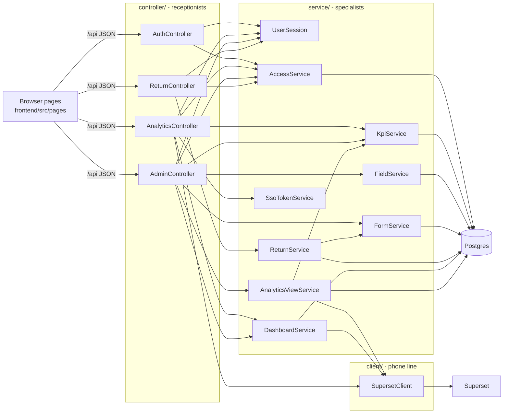

Two more files shape the database: `src/main/resources/schema.sql` (the tables) and `data.sql`
(the demo data). `application.yml` holds the settings.

### The frontend (`frontend/src/`)

```
src/
├── main.jsx                    starts the app (loads the styles, then draws it)
├── CensusAnalyticsDashboard.jsx the main frame: login check, top bar, menu, the open page
├── styles.css                  the EMIS look (colours, spacing)
├── api/        api.js (talks to the backend, logs each call), useLoad.js (loads data when a page opens)
├── logging/    logger.js ("[EMIS …]" lines in the browser console, with the request id)
├── auth/       LoginScreen.jsx, RoleSwitcher.jsx (account dropdown), roles.js (role colours)
├── layout/     Sidebar.jsx (the left menu), pages.js (the list of pages and who may open them)
├── components/ Loader.jsx (spinner), Modal.jsx (pop-up window), StatusBadge.jsx (coloured status pill)
├── formio/     FormioForm.jsx (shows a form), FormioBuilder.jsx (designs a form), formio.js (helpers)
└── pages/
    ├── dashboards/ DashboardsPage.jsx, EmbeddedAnalyticsWorkspace.jsx (one Superset dashboard)
    ├── builder/    BuilderWorkspace.jsx (Superset's chart builder in a frame)
    ├── returns/    MyFormsPage.jsx, ReviewsPage.jsx, ReturnView.jsx, ReturnTimeline.jsx
    └── admin/      KpiRegistryPage.jsx, FieldLibraryPage.jsx, FormBuilderPage.jsx, DashboardAccessPage.jsx
```

How the pieces fit together on screen. Every page talks to the backend only through `api/api.js`.

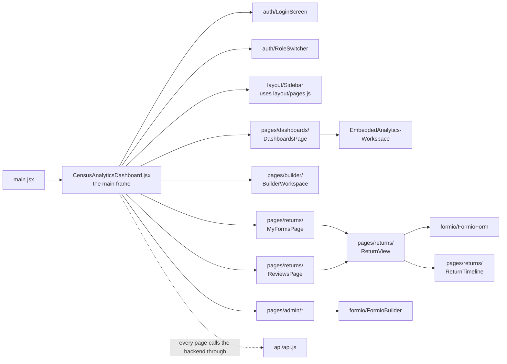

### The database tables (`public` drawer)

| Table | Holds | Example row |
|-------|-------|-------------|
| `district` | Districts | `D03`, District Three |
| `school` | Schools, with type, level and district | Sample Primary School A, Government, Primary, D03 |
| `person`, `account` | People, and logins with a scrambled (BCrypt-hashed) password | Alicia Thomas, `athomas` |
| `school_role` | Who holds which role, where, from when to when | Alicia, REGISTRAR, School A, since 1 Sept 2022 |
| `field` | The field library | `total_teachers`, "Total teachers employed", NUMBER |
| `kpi`, `kpi_field` | KPIs and their top/bottom fields | KPI-TCH-01 = `trained_teachers` ÷ `total_teachers` × 100 |
| `form`, `form_kpi` | Form designs, and which KPIs each form serves | "Annual School Census", serves KPI-TCH-01 and KPI-INF-01 |
| `form_return` | One school's return for one year, and its status | School A, 2026/2027, FROZEN |
| `form_return_value` | One answer per field | `trained_teachers` = 12 |
| `form_return_event` | The history: who did what, when, with what comment | Marcia Felix sent it back: "12 trained out of 15…" |
| `dashboard_publication` | Which roles may open each Superset dashboard | dashboard 1: MINISTER, CPU_ANALYST, DEO, PRINCIPAL |

How the tables link. For example, one school files many returns, and each return has many
answers and many history lines.
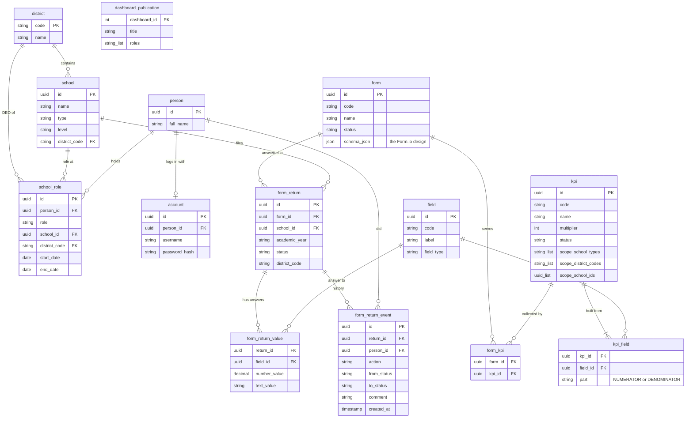

The `analytics` drawer holds one table-like view, `census_frozen`, described in Story 4.

---

## 8. How one click travels through the app

Every action, whether saving a form, approving, or opening a dashboard, follows the same path:

```
 1. You click a button on a page             e.g. pages/returns/ReturnView.jsx → saveDraft()
 2. The page asks api.js to send a request   api/api.js → putJson('/api/returns/…', data)
 3. The browser sends it, with your cookie   PUT http://localhost:3000/api/returns/… (+ a request id)
 4. Vite's dev server                        passes /api/… on to the backend (port 8081)
    The request log starts                   logging/RequestLoggingFilter: request id, user, endpoint
 5. A controller receives it                 controller/ReturnController → save()
       • checks you are logged in            service/UserSession → requireUsername()
       • checks what you may do              service/AccessService → requireViewer(), requireCapability()
 6. A service applies the rules              service/ReturnService → save()
 7. The service reads/writes the database    SQL through Spring's JdbcTemplate
    (or calls Superset through the client)   client/SupersetClient
 8. The answer goes back as JSON             a record from model/ (e.g. ReturnDetail)
 9. api.js hands it to the page              or, on an error, the backend's message
10. The page updates what you see            e.g. the status pill turns to "Draft"
```

The same journey as a sequence diagram, for Alicia's "Save draft":
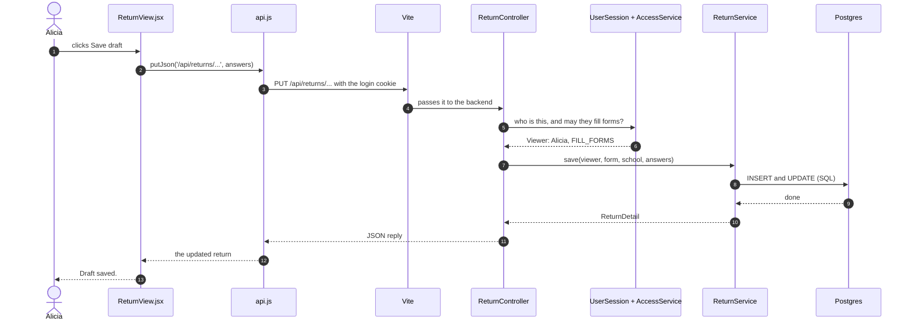

**One address for everything.** The app only ever calls `/api/...` on its *own* address
(`localhost:3000`). Vite's dev server passes those calls to the backend on port 8081. Because the
browser sees a single address, the login cookie simply works.

**Every step is logged.** The request log notes the endpoint and who asked, each controller,
service and client method writes a ▶ line when it starts and a ◀ line when it finishes, and the
request ends with its whole call trace. See [section 19](#19-logs-tracing-what-happened).

**Errors come back the same way.** If the backend refuses something, it answers with an error
code and a message, e.g. `{"status": 403, "detail": "Your role does not allow this."}`. `api.js`
turns `detail` into the red message you see. A `401` ("not logged in") from any page sends you
back to the login page (`setSessionEndedHandler`).

---

## 9. What happens when the app starts

Everything runs on this machine, started in this order (see the README for the commands):

1. **Superset** (`superset/local/start.sh`) starts on port 8088, with the EMIS colours, spinner
   and settings from `superset/superset_config.py`. That file also adds one extra page,
   `/emis/sso`, which signs Kendell in automatically (Story 6). (The first time,
   `superset/local/setup.sh` installs it and prepares its tables and `admin` user.)
2. **The backend** (IntelliJ's **SupersetPoc**, or `mvn spring-boot:run`) starts with
   `EmisAnalyticsApplication.main()`:
   - creates any missing tables (`schema.sql`) and adds the demo data (`data.sql`);
   - then `AnalyticsViewService.onStartup()` builds the "final figures" table
     (`analytics.census_frozen`, see Story 4), and tells Superset about its columns and the KPI
     formulas;
   - finally `StartupReport` writes what ran and what didn't (✔ fine, ⚠ needs attention,
     ✘ didn't work): database, SQL scripts, data counts, the view, Superset, settings, every
     endpoint, and where the log files are.
3. **The frontend** (`npm run dev` in `frontend/`) serves the app on port 3000 and forwards
   `/api` to the backend.
4. **First time only, `superset/local/provision.sh`** (`superset/scripts/provision.py`) connects
   Superset to the `analytics` drawer as the read-only user `emis_reader`. It registers the
   final-figures table, copies each KPI's formula into Superset, and builds the "Census KPIs"
   dashboard with four charts and four filters.

The backend's start-up log (real lines, shortened):

```
Start-up: EMIS backend starting on Java 25.0.4.1 in /path/to/EMIS-Superset-Poc
ScriptUtils | Executing SQL script from file [.../schema.sql]
ScriptUtils | Executed SQL script from file [.../schema.sql] in 208 ms.
ScriptUtils | Executing SQL script from file [.../data.sql]
ScriptUtils | Executed SQL script from file [.../data.sql] in 90 ms.
CorsConfig | Start-up: allowing browser calls (CORS, with cookies) from http://localhost:3000
AnalyticsViewService | Start-up: building the analytics view and syncing Superset
AnalyticsViewService | Rebuilt analytics.census_frozen with number fields [total_pupils, total_teachers, trained_teachers]
StartupReport | ================ EMIS backend: start-up report ================
StartupReport | ✔ Database: jdbc:postgresql://localhost:5432/emis_superset_app as postgres (PostgreSQL 16…)
StartupReport | ✔ Superset: reachable at http://localhost:8088
StartupReport | ✔ Endpoints (31): …
```

The same start-up as a sequence diagram:
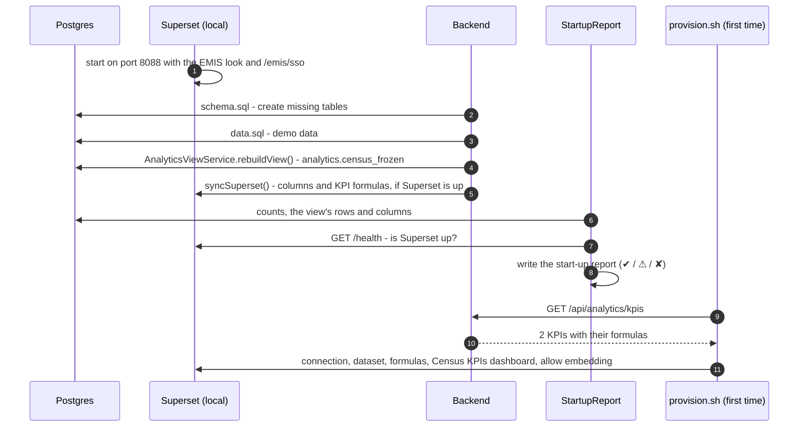

The demo data gives every school a frozen 2025/2026 census. For 2026/2027, most schools are frozen
and four are still in review, while the two demo schools (A and B) have **not started**, so the
whole story can be played.

---

## 10. Story 1: Alicia logs in

Alicia, the registrar of School A, opens the app.

The whole login at a glance (the steps below explain each arrow):

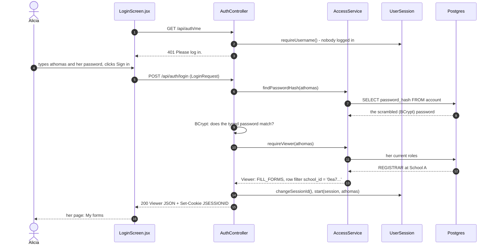

**Step 1: The app checks whether she is already logged in.**
- Where: `CensusAnalyticsDashboard.jsx`, as it first opens → `getJson('/api/auth/me')`.
- Backend: `AuthController.me()` → `UserSession.recordActivity()` → `requireUsername()` finds
  no login in this browser.
- Answer: `401 "Please log in."` → the app shows the login page (`auth/LoginScreen.jsx`).

**Step 2: She types her username and password and presses "Sign in".**
- Where: `LoginScreen.jsx` → `handleSubmit()` → `postJson('/api/auth/login', …)`.
- Sends:

  ```json
  { "username": "athomas", "password": "Census#2026" }
  ```

  (On the backend this arrives as the record `dto/request/LoginRequest`.)

**Step 3: The backend checks the password.**
- `AuthController.login()` asks `AccessService.findPasswordHash("athomas")`. That reads the
  stored, scrambled password from `account`; the real password is never stored.
- `BCryptPasswordEncoder.matches()` scrambles what she typed the same way and compares the two.
- If they don't match, the answer is `401 "Wrong username or password."`. It doesn't say which
  of the two was wrong, so nobody can guess usernames.

**Step 4: The backend works out who she is and what she may do.**
- `AccessService.requireViewer("athomas")` → `findViewer()` reads her **current** roles (started,
  and not ended) from `school_role`.
- Registrar at School A means:
  - she may **fill in forms**: capability `FILL_FORMS`;
  - her rows are limited to her school: the row filter is `school_id = '0ea7…'`.

**Step 5: The backend starts her session.**
- It gives the browser a fresh session id (`changeSessionId()`), so an id that existed before
  login is useless. Then `UserSession.start()` writes "athomas, last active now" into the session.

**Step 6: The answer.** The browser receives a cookie and a description of Alicia (the record
`model/Viewer`). Real answer:

```
Set-Cookie: JSESSIONID=03521F0524CE0ACA207A101663132D70; Path=/; HttpOnly; SameSite=Lax
```

```json
{
  "personId": "2d3c4ed6-4c6f-4939-97f9-74ff58111082",
  "username": "athomas",
  "fullName": "Alicia Thomas",
  "roles": ["REGISTRAR"],
  "places": [{ "role": "REGISTRAR", "schoolId": "0ea77561-3eaa-494c-bf84-3835196a1555",
               "schoolName": "Sample Primary School A", "districtCode": "D03" }],
  "scopes": ["Sample Primary School A"],
  "rlsClause": "school_id = '0ea77561-3eaa-494c-bf84-3835196a1555'",
  "capabilities": ["FILL_FORMS"]
}
```

`HttpOnly` means page scripts can't read the cookie, which protects it from theft. `SameSite=Lax`
means other websites can't use it.

**Step 7: The app builds her screen.** `handleLogin()` keeps the description. `layout/pages.js` →
`pagesFor(viewer)` keeps only the pages whose capability she has: just **My forms**.
`layout/Sidebar.jsx` shows that one menu item, and her first page opens.

For comparison, the same login answer for Kendell (CPU analyst) and the Minister:

| | Kendell St. Rose | Hon. Grace Laurent |
|---|---|---|
| `capabilities` | `DASHBOARDS`, `BUILD`, `MANAGE_KPIS`, `REVIEW` | `DASHBOARDS` |
| `rlsClause` | `null` (no filter: the whole country) | `null` |
| Menu | 7 pages | Dashboards only |

---

## 11. Story 2: Alicia fills in the census form

The whole story at a glance (the sections below explain each step):
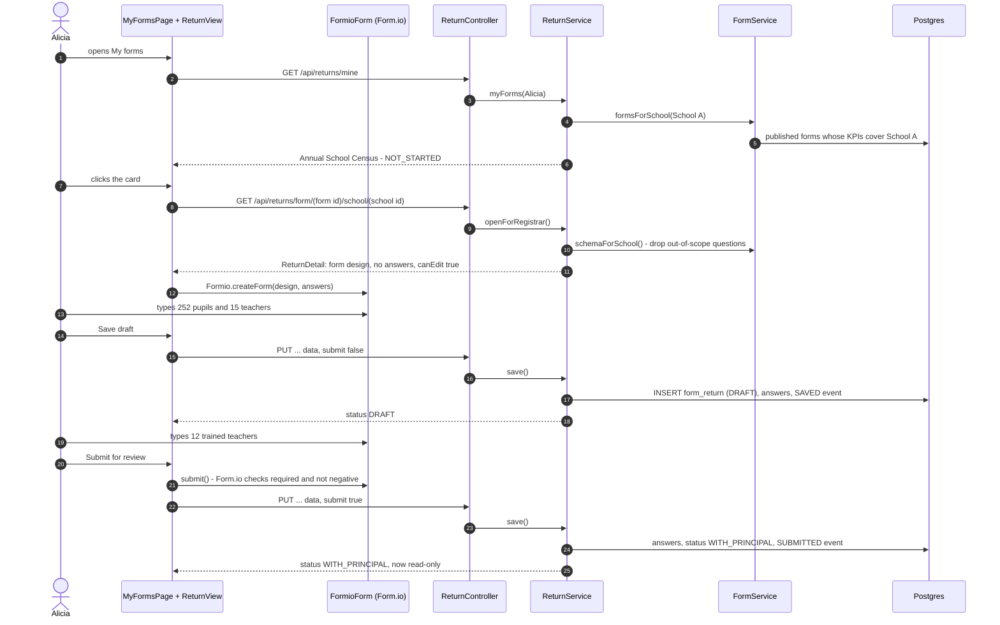

### 11.1 Her list of forms

- Where: `pages/returns/MyFormsPage.jsx` opens → `useLoad('/api/returns/mine')`.
- Backend: `ReturnController.mine()` checks she has `FILL_FORMS`, then
  `ReturnService.myForms(viewer)`. For each school where she is registrar:
  - `FormService.formsForSchool(schoolId)` finds the **published** forms her school must fill in
    (a form whose KPIs don't cover her school is skipped);
  - each form comes with this year's return (`emis.reporting-year` = `2026/2027`), or "not started".
- Real answer:

  ```json
  [{ "id": null, "formId": "b148277f-2065-45ee-8c92-5c9e38f754ee",
     "formName": "Annual School Census", "schoolName": "Sample Primary School A",
     "districtCode": "D03", "academicYear": "2026/2027",
     "status": "NOT_STARTED", "actionable": true }]
  ```

- On screen: one card, "Annual School Census · Not started · Start →".

### 11.2 Opening the form

- Where: she clicks the card → `MyFormsPage.openItem()` →
  `getJson('/api/returns/form/b148277f…/school/0ea77561…')`.
- Backend: `ReturnController.open()` → `ReturnService.openForRegistrar()`:
  1. `requireRegistrar()`: she must be registrar of *this* school, otherwise `403`.
  2. `detail()` gathers four things:
     - **the form, as her school sees it.** `FormService.schemaForSchool()` removes questions
       that only out-of-scope KPIs need. Nothing is removed here, because both census KPIs cover
       every school.
     - **the saved answers.** None yet: `{}`.
     - **the history.** Empty.
     - **`canEdit`.** `true`: she is the registrar, and it is not submitted.
- The form travels as a Form.io definition, a description of the questions (shortened):

  ```json
  { "display": "form", "components": [
      { "type": "panel", "title": "Enrolment", "components": [
          { "type": "number", "key": "total_pupils", "label": "Total pupils on roll",
            "validate": { "required": true, "min": 0 } } ] },
      { "type": "panel", "title": "Teachers", "components": [
          { "type": "number", "key": "total_teachers", … },
          { "type": "number", "key": "trained_teachers", … } ] } ] }
  ```

  The important part is the `key`: it is the **field code**. That is how the app knows "this
  answer is the number of trained teachers".
- On screen: `pages/returns/ReturnView.jsx` shows:
  - the step tracker (`ReturnTimeline.jsx` → `WorkflowTracker`), with "Registrar" highlighted;
  - the form, drawn by `formio/FormioForm.jsx` → `Formio.createForm()`. Form.io's code is
    downloaded only now (`formio.js` → `loadFormio()`), so users who never open a form never load it;
  - the buttons "Save draft" and "Submit for review".

### 11.3 Saving a draft

Alicia types 252 pupils and 15 teachers, then clicks **Save draft**.

- Where: `ReturnView.saveDraft()` reads the answers from the form
  (`formRef.current.submission.data`) → `putJson('/api/returns/form/…/school/…', …)`.
- Sends (record `dto/request/SaveReturnRequest`):

  ```json
  { "data": { "total_pupils": 252, "total_teachers": 15 }, "submit": false }
  ```

- Backend: `ReturnController.save()` → `ReturnService.save()`:
  1. **A first save creates the return** in `form_return` as `DRAFT`. It copies the school's
     district, type and level onto it, so the return keeps its district even if the school later
     moves.
  2. **The answers are stored.** For each question her school is asked that is a library field,
     the old answer is deleted and the new one stored in `form_return_value`. Numbers go through
     `toNumber()`, which refuses text and negative numbers.
  3. **The save is recorded** in the history (`SAVED`). Repeated saves are recorded only once.
- Answer: the updated return. Status `DRAFT`, answers
  `{"total_pupils": 252, "total_teachers": 15}`, `canEdit: true`. A blue note says "Draft saved."

### 11.4 Submitting

**First, a mistake:** she clicks **Submit for review** without the trained-teachers figure.

- In the browser, `ReturnView.submit()` first runs `formRef.current.submit()`. Form.io's own
  check sees the empty required box and marks it red: "Trained teachers is required". Nothing is sent.
- The backend checks too, in case a request skips the page. Sent directly, the real answer is:
  `400 "Answer 'trained_teachers' before submitting."`

**Then correctly:** she types 12 and submits.

- Sends: `{ "data": { "total_pupils": 252, "total_teachers": 15, "trained_teachers": 12 }, "submit": true }`
- Backend: `ReturnService.save()` stores the answers, checks every number question has an answer,
  then `move(DRAFT → WITH_PRINCIPAL, "SUBMITTED")`.
- On screen: the status pill reads "With principal", the tracker's first step turns green, the
  form becomes read-only, and the history shows "Alicia Thomas submitted it for review → With principal".
- If she tries to change it now, the answer is `409 "This return was already submitted…"`.

**What the database now holds** (real rows, after the whole story):

```
form_return:        81511b1c-…  | 2026/2027 | D03 | Government | Primary | (status changes as it moves)
form_return_value:  total_pupils = 252,  total_teachers = 15,  trained_teachers = 12
```

---

## 12. Story 3: The return is reviewed and frozen

The return now climbs a ladder. At each rung, exactly one kind of person may act:

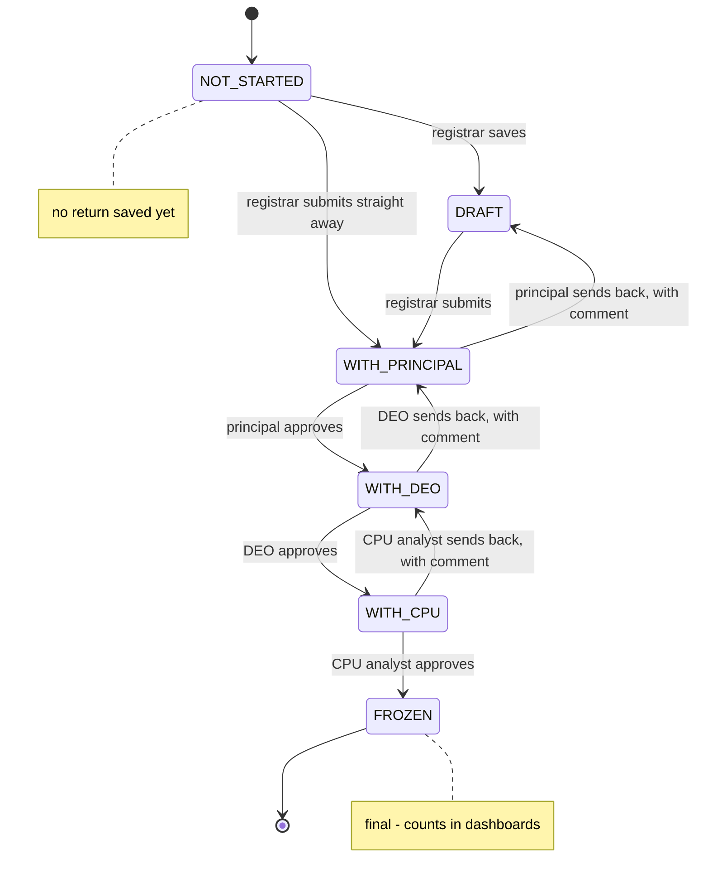


Approving moves it one rung up. **Sending back** moves it one rung down, and always needs a comment.

### 12.1 Brenda (principal) approves

- Where: Brenda opens **Reviews**: `pages/returns/ReviewsPage.jsx` →
  `useLoad('/api/returns/reviews')`.
- Backend: `ReturnController.reviews()` (needs `REVIEW`) → `ReturnService.reviewList()`.
  - She sees this year's returns for the schools where she is principal.
  - Each one is marked `actionable` if it is waiting for *her* (`toSummary()`):

    | Status | Waiting for |
    |--------|-------------|
    | With principal | the principal of that school |
    | With DEO | the DEO of that district |
    | With CPU analyst | any CPU analyst |

- On screen: "Waiting for me (1)", showing School A with a blue "Review" button.
- She opens it (`getJson('/api/returns/81511b1c…')` → `ReturnService.openById()`). `canSee()`
  checks she may see this school, then she gets the same form, read-only, plus a comment box,
  "Send back" and "Approve".
- She approves with a comment:
  `postJson('/api/returns/81511b1c…/review', { "action": "APPROVE", "comment": "Checked against the admission register." })`
- Backend: `ReturnController.review()` → `ReturnService.review()`:
  - it is waiting for her, so it moves one step up with
    `move(WITH_PRINCIPAL → WITH_DEO, "APPROVED")`;
  - `move()` only changes the status if it is *still* `WITH_PRINCIPAL`, so two people clicking
    at the same moment can't both move it;
  - `addEvent()` writes the history line.

Brenda's approval, step by step:
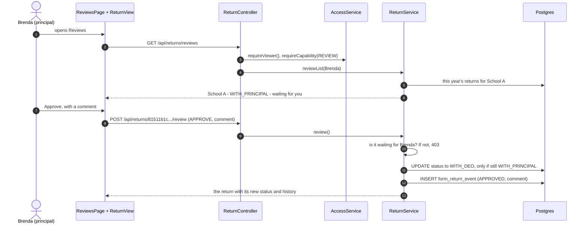

**Someone else tries.** Martin Joseph (principal of School B) sends the same approval. Real
answer: `403 "This return is not waiting for you."`

### 12.2 Marcia (DEO) sends it back

- Marcia's Reviews list holds the 13 returns of District D03. Two are waiting for her: Riviere
  Douce Primary (from the demo data) and School A.
- She thinks 12 trained teachers looks high. If she clicks "Send back" without a comment, the
  button stays disabled. The backend refuses too: `400 "Say why you are sending it back."`
- With a comment:
  `{ "action": "RETURN", "comment": "12 trained out of 15 is higher than last year (11). Please confirm." }`
- Backend: `move(WITH_DEO → WITH_PRINCIPAL, "RETURNED", comment)`, one step down.
- On screen: the history shows her comment in amber. The return is back with Brenda.

### 12.3 Back up the ladder to "frozen"

| Who | Action | Comment | Status after |
|-----|--------|---------|--------------|
| Brenda Francis | approve | "Confirmed: one teacher qualified in July." | With DEO |
| Patricia Williams (DEO of D02) | tries to approve | — | refused: `403 "This return is not waiting for you."` |
| Marcia Felix | approve | — | With CPU analyst |
| Kendell St. Rose | **Approve and freeze** | — | **Frozen** |

At the CPU step the button reads **Approve and freeze**: the next rung is "Frozen".

**The full history, as stored in `form_return_event`** (real, times in UTC):

| Time | Who | Action | From → To | Comment |
|------|-----|--------|-----------|---------|
| 12:29:16.017 | Alicia Thomas | saved a draft | Draft → Draft | |
| 12:29:16.102 | Alicia Thomas | submitted | Draft → With principal | |
| 12:29:16.209 | Brenda Francis | approved | With principal → With DEO | Checked against the admission register. |
| 12:29:16.273 | Marcia Felix | sent back | With DEO → With principal | 12 trained out of 15 is higher than last year (11). Please confirm. |
| 12:29:16.301 | Brenda Francis | approved | With principal → With DEO | Confirmed: one teacher qualified in July. |
| 12:29:16.343 | Marcia Felix | approved | With DEO → With CPU analyst | |
| 12:29:16.370 | Kendell St. Rose | approved | With CPU analyst → **Frozen** | |

(The times are a fraction of a second apart because this example was played by a script. In real
life the steps would be days apart.)

**If a principal sends a return back to the registrar,** it becomes a Draft again. Alicia's card
then shows "Sent back: …" with the comment, and she can edit and resubmit.

---

## 13. Story 4: The numbers reach Brenda's dashboard

### 13.1 The "final figures" table

Charts need a simple table: one row per school and year, one column per number. Answers are stored
one per row instead (`form_return_value`), so the backend keeps a **view**, a saved query that
looks like a table: `analytics.census_frozen`.

`AnalyticsViewService.rebuildView()` writes it, with one column per NUMBER field in the library:

```sql
CREATE VIEW analytics.census_frozen AS
SELECT r.school_id, s.name AS school_name, r.academic_year,
       r.district_code, r.school_type, r.school_level,
       MAX(v.number_value) FILTER (WHERE f.code = 'total_pupils')     AS total_pupils,
       MAX(v.number_value) FILTER (WHERE f.code = 'total_teachers')   AS total_teachers,
       MAX(v.number_value) FILTER (WHERE f.code = 'trained_teachers') AS trained_teachers
FROM form_return r
JOIN school s ON s.id = r.school_id
LEFT JOIN form_return_value v ON v.return_id = r.id
LEFT JOIN field f ON f.id = v.field_id
WHERE r.status = 'FROZEN'          -- only final returns, never drafts
GROUP BY r.school_id, s.name, r.academic_year, r.district_code, r.school_type, r.school_level;
```

In plain words: "for every frozen return, put each number answer in its own column". Because it is
a view, School A's new row appears **the moment** Kendell freezes it. Real rows for School A:

| school_name | academic_year | district_code | total_pupils | total_teachers | trained_teachers |
|-------------|---------------|---------------|-------------:|---------------:|-----------------:|
| Sample Primary School A | 2025/2026 | D03 | 248 | 15 | 11 |
| Sample Primary School A | 2026/2027 | D03 | 252 | 15 | 12 |

How School A's answers become the figure on Brenda's chart:
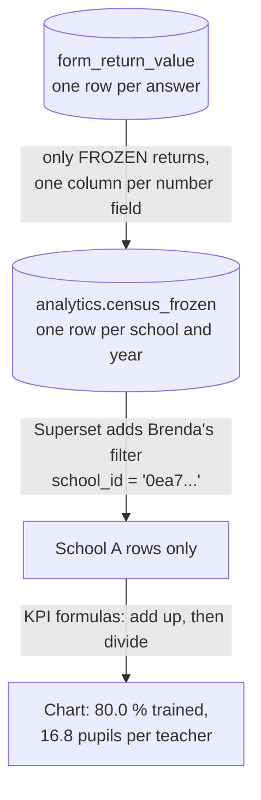

### 13.2 Brenda opens Dashboards

The whole journey at a glance (the steps below explain each arrow):

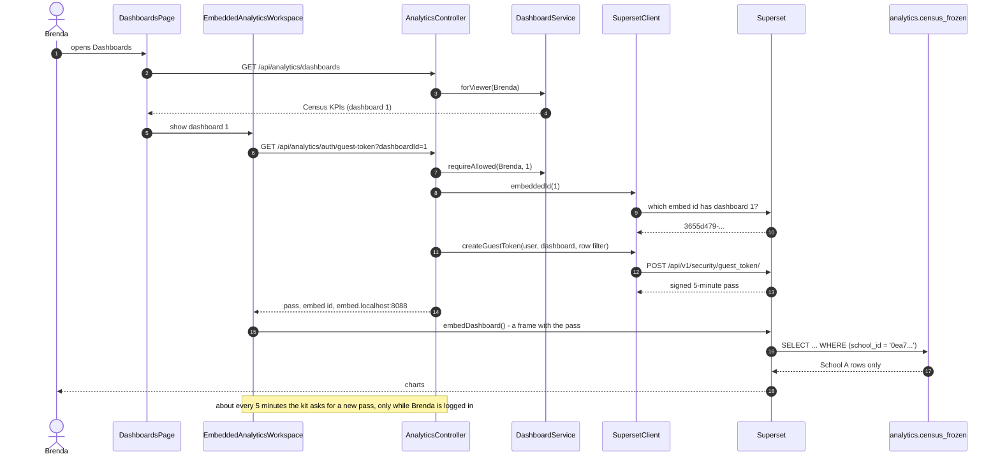

**Step 1: Which dashboards may she open?**
- Where: `pages/dashboards/DashboardsPage.jsx` → `useLoad('/api/analytics/dashboards')`.
- Backend: `AnalyticsController.dashboards()` (needs `DASHBOARDS`) →
  `DashboardService.forViewer()`. That reads `dashboard_publication` for dashboards published to
  any of her roles.
- Real answer:

  ```json
  [{ "dashboardId": 1, "title": "Census KPIs", "roles": ["MINISTER", "CPU_ANALYST", "DEO", "PRINCIPAL"] }]
  ```

**Step 2: She gets a visitor pass for that dashboard.**
- Where: `pages/dashboards/EmbeddedAnalyticsWorkspace.jsx` → `showDashboard()` →
  `getJson('/api/analytics/auth/guest-token?dashboardId=1')`.
- Backend: `AnalyticsController.guestToken()`:
  1. `UserSession.requireUsername()`: is she still logged in? This check does **not** count as
     activity (see section 17).
  2. `requireCapability(DASHBOARDS)`, then `DashboardService.requireAllowed()`: is dashboard 1
     published to the principal role? If not, `403`.
  3. `SupersetClient.embeddedId("1")` asks Superset for the dashboard's embed id.
  4. `SupersetClient.createGuestToken()` asks Superset for a pass. Behind the scenes it logs in
     as the service account, fetches a CSRF token (Superset's anti-forgery check), then
     `POST /api/v1/security/guest_token/` with:

     ```json
     { "user": { "username": "bfrancis", "first_name": "Brenda", "last_name": "Francis" },
       "resources": [{ "type": "dashboard", "id": "3655d479-296a-4965-953c-db60007d2e74" }],
       "rls": [{ "clause": "school_id = '0ea77561-3eaa-494c-bf84-3835196a1555'" }] }
     ```

- Real answer to the browser (record `dto/response/GuestTokenResponse`):

  ```json
  { "token": "eyJhbGciOiJIUzI1NiIsInR5cCI6IkpXVCJ9.eyJ…",
    "dashboardId": "3655d479-296a-4965-953c-db60007d2e74",
    "supersetDomain": "http://embed.localhost:8088" }
  ```

- What is inside the pass (the token, decoded):

  ```json
  { "user": { "username": "bfrancis", "first_name": "Brenda", "last_name": "Francis" },
    "resources": [{ "type": "dashboard", "id": "3655d479-296a-4965-953c-db60007d2e74" }],
    "rls_rules": [{ "clause": "school_id = '0ea77561-3eaa-494c-bf84-3835196a1555'" }],
    "iat": 1793190556.81, "exp": 1793190856.81, "aud": "emis-superset", "type": "guest" }
  ```

  `exp − iat = 300` seconds: the pass works for 5 minutes. Anyone can *read* it, but changing it
  (say, deleting the filter) breaks Superset's signature, and Superset rejects it.

  The Minister's pass for the same dashboard has `"rls_rules": []`: no filter, the whole country.

**Step 3: The dashboard appears.**
- `embedDashboard()` (from Superset's embedding kit, `@superset-ui/embedded-sdk`) puts a frame on
  the page showing `http://embed.localhost:8088/embedded/3655d479-…`, and hands it the pass.
- `embed.localhost` is the same Superset under a second name. Superset signs the browser out on
  the address it embeds from, and using a different name keeps Kendell's builder login (on
  `localhost`) untouched.
- Before each pass expires, the kit calls `fetchGuestToken()` for a new one. This keeps working
  only while Brenda's EMIS login is valid.

**Step 4: Superset asks the database.** For each chart, Superset checks the pass, then **adds the
pass's filter** to its question. For the "KPIs by school" chart, Superset's question is:

```sql
SELECT academic_year, district_code, school_name,
       SUM(total_pupils) * 1.0 / NULLIF(SUM(total_teachers), 0)       AS kpi_inf_01,  -- Pupil-teacher ratio
       SUM(trained_teachers) * 100.0 / NULLIF(SUM(total_teachers), 0) AS kpi_tch_01   -- Trained teacher %
FROM analytics.census_frozen
WHERE (school_id = '0ea77561-3eaa-494c-bf84-3835196a1555')   -- added by Superset from Brenda's pass
GROUP BY academic_year, district_code, school_name
ORDER BY kpi_inf_01 DESC
LIMIT 1000;
```

The formulas came from the KPI registry (Story 5). The `WHERE` line came from Brenda's role,
through the pass. Superset runs it as `emis_reader`, which can only read the `analytics` drawer.

**Step 5: The result** (real, fetched with Brenda's pass):

| academic_year | school_name | Pupil-teacher ratio | Trained teacher % |
|---------------|-------------|--------------------:|------------------:|
| 2026/2027 | Sample Primary School A | 16.8 (252 ÷ 15) | 80.0 (12 ÷ 15 × 100) |
| 2025/2026 | Sample Primary School A | 16.5 (248 ÷ 15) | 73.3 (11 ÷ 15 × 100) |

Only School A, and both years, including the return frozen a moment ago.

**Why add first and divide later?** A district's "Trained teacher %" must be all trained teachers
in the district ÷ all teachers in the district, not an average of each school's percentage. The
formula `SUM(…) ÷ SUM(…)` does exactly that, so big schools count more than small ones.

---

## 14. Story 5: Kendell defines a new KPI, field and form

*This example was played while testing the app. It is not in the demo data.*

Kendell wants a new KPI, "Girls share of enrolment", but only District D02 has to report it this
year.

The whole story at a glance (the sections below explain each step):
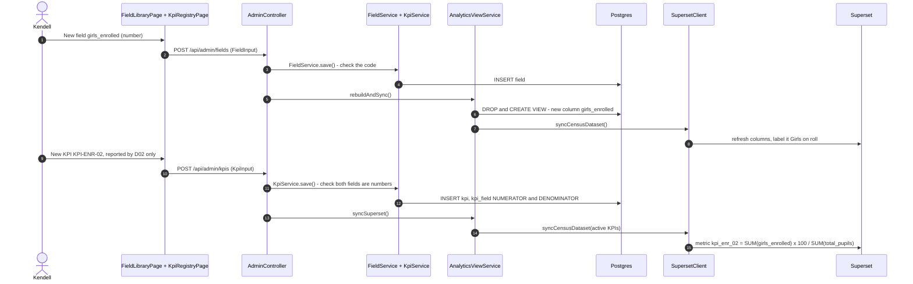

### 14.1 A new field: "Girls on roll"

- Where: **Field library** (`pages/admin/FieldLibraryPage.jsx`) → "New field" → `save()` →
  `postJson('/api/admin/fields', …)`.
- Sends (record `dto/request/FieldInput`):
  `{ "code": "girls_enrolled", "label": "Girls on roll", "fieldType": "NUMBER", "active": true }`
- Backend: `AdminController.createField()` checks she has `MANAGE_KPIS` (`requireAdmin()`), then
  `FieldService.save()` → `validate()`:
  - **the code** must be lowercase letters, digits and `_`, because it becomes a column name.
    `Girls` was refused with "The code must use lowercase letters, digits and underscores, e.g. total_pupils.";
  - **reserved names** such as `school_id` are refused, since the view already has them;
  - **a choice-list field** must list its choices.
- Because it is a number field, `AnalyticsViewService.rebuildAndSync()` runs at once:
  - the view gains a `girls_enrolled` column;
  - Superset re-reads the columns and labels it "Girls on roll".

### 14.2 A new KPI

- Where: **KPI registry** (`pages/admin/KpiRegistryPage.jsx`) → "New KPI".
- The pop-up has:
  - code, name, category and definition;
  - **numerator**: Girls on roll; **denominator**: Total pupils on roll; **multiplier**: × 100
    (percentage);
  - **status**: Active;
  - **who reports it**: districts ✓ D02.

  The pop-up previews the formula: `Σ girls_enrolled × 100 ÷ Σ total_pupils`.
- Sends (record `dto/request/KpiInput`):

  ```json
  { "code": "KPI-ENR-02", "name": "Girls share of enrolment", "category": "Access",
    "multiplier": 100, "status": "ACTIVE",
    "numeratorFieldId": "c443cf92-…", "denominatorFieldId": "29489931-…",
    "scopeSchoolTypes": [], "scopeDistrictCodes": ["D02"], "scopeSchoolIds": [] }
  ```

- Backend: `AdminController.createKpi()` → `KpiService.save()`:
  1. `validate()`: the code looks like `KPI-ENR-02`, there is a name and a positive multiplier,
     and both fields exist and are numbers (`requireNumberField()`).
  2. It saves the KPI with its scope, plus two `kpi_field` rows (NUMERATOR, DENOMINATOR).
  3. `AnalyticsViewService.syncSuperset()` turns the active KPI into a Superset formula
     (`KpiService.metricExpression()`):
     `kpi_enr_02` = `SUM(girls_enrolled) * 100.0 / NULLIF(SUM(total_pupils), 0)`.
     (`NULLIF` avoids dividing by zero; `.0` keeps decimals.) It appears at once in the chart
     builder as "Girls share of enrolment".

How a KPI looks in the registry list (real, `model/KpiDetail`):

```json
{ "code": "KPI-TCH-01", "name": "Trained teacher %", "category": "Teacher Development",
  "multiplier": 100, "status": "ACTIVE",
  "numeratorField": "trained_teachers", "denominatorField": "total_teachers",
  "scopeSchoolTypes": [], "scopeDistrictCodes": [], "scopeSchoolIds": [],
  "metricName": "kpi_tch_01",
  "metricExpression": "SUM(trained_teachers) * 100.0 / NULLIF(SUM(total_teachers), 0)" }
```

Empty scope lists mean "every school reports it". One field can feed many KPIs: the field library
shows `total_teachers` "Used by KPIs: KPI-INF-01, KPI-TCH-01".

### 14.3 Adding the question to the census form

- Where: **Form builder** (`pages/admin/FormBuilderPage.jsx`) → edit "Annual School Census".
  `openEditor()` loads the form (`GET /api/admin/forms/{id}`), and `formio/FormioBuilder.jsx`
  draws the Form.io drag-and-drop designer.
- The designer's left menu starts with a **Field library** group: one ready-made question per
  field, built by `formio.js` → `componentFor(field)`:
  - each question's key is already the field code;
  - number questions are required and can't be negative.
- Kendell ticks **KPI-ENR-02** under "KPIs this form collects", then clicks **Add questions for the
  ticked KPIs** (`addKpiQuestions()`). That adds a section with the KPI's missing fields; here,
  "Girls on roll". (`total_pupils` is already in the form, so it is not added twice.)
- **Save form** → `putJson('/api/admin/forms/{id}', { code, name, description, status: "PUBLISHED", kpiIds, schema })`
  → `FormService.save()`:
  - **publishing checks every question's key is a library field.** A question keyed `girlsx`
    was refused with
    `400 "These question keys are not fields in the field library: girlsx. Set each question's Property Name to a field code."`
  - then it saves the design and its KPI links.

### 14.4 What the registrars see now (KPI scope in action)

Both registrars open the census. `FormService.schemaForSchool()` removes questions that only KPIs
outside the school's scope need:

How `schemaForSchool()` decides, for each question:
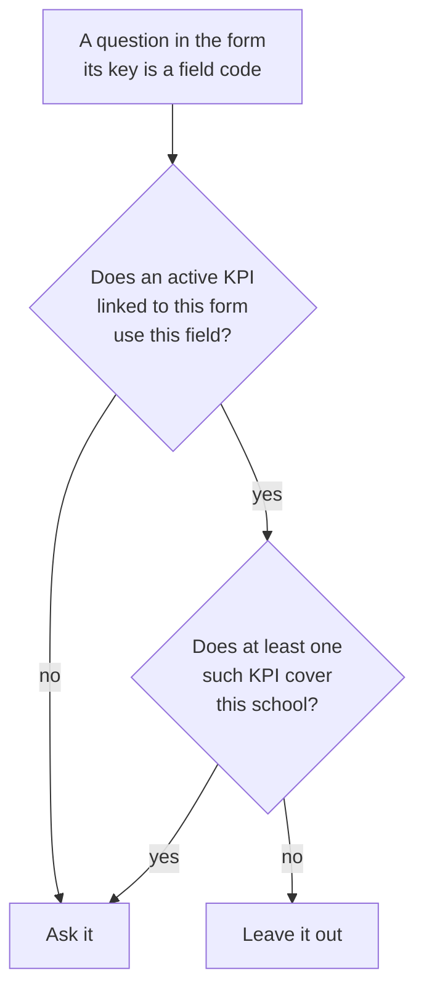

| Registrar | School (district) | Questions shown |
|-----------|-------------------|-----------------|
| Natalie Charles | School B (D02) | total_pupils, **girls_enrolled**, total_teachers, trained_teachers |
| Alicia Thomas | School A (D03) | total_pupils, total_teachers, trained_teachers |

KPI-ENR-02 covers D02 only, so School A is never asked about girls on roll.

---

## 15. Story 6: Kendell builds and publishes a dashboard

### 15.1 Opening the chart builder (automatic sign-in)

Superset has its own logins. Kendell should not need a second password, so EMIS signs her in.


```mermaid
sequenceDiagram
    autonumber
    actor K as Kendell
    participant BW as BuilderWorkspace
    participant AN as AnalyticsController
    participant ST as SsoTokenService
    participant SS as Superset /emis/sso
    K->>BW: opens Chart builder
    BW->>AN: GET /api/analytics/builder?page=explore
    AN->>AN: requireCapability(BUILD)
    AN->>ST: createToken(Kendell)
    ST-->>AN: one-minute signed ticket
    AN-->>BW: link to /emis/sso with the ticket and the next page
    BW->>SS: the frame opens the link
    SS->>SS: check signature, expiry and purpose - if wrong, 403
    SS->>SS: find or create user kstrose (Admin), sign her in
    SS-->>BW: go to /explore/ (Superset pages only)
    BW-->>K: the chart builder, already signed in
```

- Where: **Chart builder** (`pages/builder/BuilderWorkspace.jsx`) → `open('explore')` →
  `getJson('/api/analytics/builder?page=explore')`.
- Backend: `AnalyticsController.builder()`:
  1. checks `BUILD`;
  2. picks the Superset page: a new chart on the census data, with Superset's own menu hidden
     (`uiConfig=4`);
  3. `SsoTokenService.createToken()` makes a **one-minute ticket**, signed with a secret that only
     the backend and Superset know (`EMIS_SSO_SECRET`).
- Real answer (record `dto/response/BuilderResponse`):

  ```json
  { "url": "http://localhost:8088/emis/sso?token=eyJ0eXAiOiJKV1QiLCJhbGciOiJIUzI1NiJ9.eyJzdWIiOi…&next=%2Fexplore%2F%3Fdatasource_type%3Dtable%26datasource_id%3D1%26uiConfig%3D4",
    "supersetDomain": "http://localhost:8088" }
  ```

  The ticket, decoded: `{"sub": "kstrose", "first_name": "Kendell", "last_name": "St. Rose",
  "email": "kstrose@emis.local", "aud": "superset-sso", "exp": 1793190617}`
- The frame opens that link. Superset's `/emis/sso` page (in `superset_config.py`,
  `emis_sso_login()`):
  1. checks the ticket's signature, that it hasn't expired, and that it was made for this page.
     A forged or old ticket gets `403`;
  2. finds Kendell's Superset user, or creates it the first time (no password, Admin role);
  3. signs her in, then sends her to the page in `next`. Only addresses on Superset itself are
     allowed, so the link can't be used to send someone to another website.
- She now builds charts in Superset (every field is explained in [CHART_BUILDER_GUIDE.md](CHART_BUILDER_GUIDE.md)). **Full screen**, on the right of the toolbar, lets Superset use the whole window so the preview has room; only the page's CSS changes, so nothing reloads.
- In Superset, her KPI formulas are ready in the list ("Trained teacher %",
  "Pupil-teacher ratio"), and columns have friendly names ("Total pupils on roll", "District").
  The toolbar switches between **New chart**, **Charts** and **Dashboards**. Each tab fetches a
  fresh link the same way.

### 15.2 Publishing a dashboard to roles


```mermaid
sequenceDiagram
    autonumber
    actor K as Kendell
    participant DA as DashboardAccessPage
    participant AD as AdminController
    participant DS as DashboardService
    participant SC as SupersetClient
    participant SS as Superset
    participant DB as Postgres
    K->>DA: opens Dashboard access
    DA->>AD: GET /api/admin/dashboards
    AD->>DS: listAll()
    DS->>SC: listDashboards()
    SC->>SS: GET /api/v1/dashboard/
    DS->>DB: roles saved for each dashboard
    DS-->>DA: dashboards with their roles
    K->>DA: ticks Minister and DEO
    DA->>AD: PUT /api/admin/dashboards/3 (title, roles)
    AD->>DS: publish()
    DS->>SC: enableEmbedding(3)
    SC->>SS: POST /api/v1/dashboard/3/embedded - allowed addresses
    DS->>DB: save the roles in dashboard_publication
    DS-->>DA: published
```

- Where: **Dashboard access** (`pages/admin/DashboardAccessPage.jsx`) →
  `useLoad('/api/admin/dashboards')`.
- Backend: `DashboardService.listAll()` → `SupersetClient.listDashboards()` asks Superset for
  every dashboard, then adds the roles saved in `dashboard_publication`. Real answer:

  ```json
  [{ "id": 3, "title": "[ untitled dashboard ]", "published": false, "changed": "5 hours ago", "roles": [] },
   { "id": 1, "title": "Census KPIs", "slug": "census-kpis", "published": true, "changed": "19 hours ago",
     "roles": ["MINISTER", "CPU_ANALYST", "DEO", "PRINCIPAL"] }]
  ```

- She ticks a role's checkbox → `toggleRole()` →
  `putJson('/api/admin/dashboards/3', { "title": "…", "roles": ["MINISTER", "DEO"] })` →
  `DashboardService.publish()`:
  1. only the four viewing roles are accepted;
  2. `SupersetClient.enableEmbedding(3)` tells Superset the EMIS app may show this dashboard in a frame;
  3. it saves the roles.
- From then on, the Minister and every DEO find it under **Dashboards**, as a second tab. Each DEO
  still sees only their own district: the row filter always applies.
- The "Census KPIs" dashboard is published to all four roles automatically the first time anyone
  asks (`publishDefaultIfNone()`).
- **Edit in builder** on a row opens that dashboard in the chart builder (`openBuilder()`, then
  `?page=dashboard&dashboardId=3`).

---

## 16. Refreshing dashboards

- **Every 15 minutes**, `DashboardsPage` reloads the dashboard by itself (`setInterval(refresh, 15 min)`).
- **"Refresh now"** does the same at once. The toolbar shows when it last refreshed,
  e.g. "Updated 05:44 PM · refreshes every 15 min".
- **How it reloads:** `refresh()` re-reads the list of dashboards (a newly published one appears),
  then raises a counter that is part of the dashboard's identity (`key`). React treats it as a new
  dashboard: it gets a fresh pass and Superset asks the database again.
- **The figures are always fresh:** Superset's data cache is off here (its default), so a reload
  always shows them. A return frozen five minutes ago is in the next refresh.
- **Moving between pages does *not* reload anything.** The Dashboards and Chart builder pages stay
  loaded in the background and are only hidden, so there is no spinner when you come back.

```mermaid
sequenceDiagram
    autonumber
    participant T as 15-minute timer or Refresh now
    participant DP as DashboardsPage
    participant EW as EmbeddedAnalyticsWorkspace
    participant BE as Backend
    participant SS as Superset
    T->>DP: refresh()
    DP->>BE: GET /api/analytics/dashboards - any new ones?
    DP->>DP: refreshCount + 1, so the dashboard gets a new key
    DP->>EW: remove the old dashboard, mount a new one
    EW->>BE: a new visitor pass
    EW->>SS: embed again
    SS-->>EW: charts with the latest frozen figures
```

---

## 17. Switching account, signing out and timing out

**Switching account (demo only).** The dropdown at the top right (`auth/RoleSwitcher.jsx`) lists
everyone (`GET /api/auth/demo-users`). Picking someone sends
`postJson('/api/auth/switch', { "username": "bfrancis" })` → `AuthController.switchUser()` →
`UserSession.start()` with the new name. The app then opens the new person's first page. Their
dashboard and builder start fresh, because they are keyed by username. Turn this off with
`DEMO_SWITCH_ENABLED=false`.

**Signing out.**
- "Sign out" → `POST /api/auth/logout` → `UserSession.end()` throws the session away.
- The app shows the login page, and the dashboard frame is removed at once.
- No new visitor pass will be given. A pass already in the browser keeps working until its
  5-minute end.

Signing out, step by step:
```mermaid
sequenceDiagram
    autonumber
    actor U as User
    participant APP as CensusAnalyticsDashboard
    participant AC as AuthController
    participant US as UserSession
    participant EW as Dashboard frame
    participant BW as BuilderWorkspace
    participant SS as Superset
    U->>APP: Sign out
    APP->>AC: POST /api/auth/logout
    AC->>US: end(session)
    AC-->>APP: 204
    APP->>EW: removed - dashboard.unmount()
    APP->>BW: removed
    BW->>SS: hidden frame opens /logout/ - CPU analyst only
    APP-->>U: login page - You have signed out.
```

**Kendell's Superset login ends too.** When the chart builder closes (sign out, time out, or
switching away from Kendell), `BuilderWorkspace` opens Superset's `/logout/` in an invisible frame
for a few seconds. As a safety net, a login made through `/emis/sso` expires after 8 hours anyway.

**Timing out after 30 minutes of doing nothing.** `UserSession` remembers when the user last *did*
something:

| What happens | Checks the login | Counts as activity |
|--------------|:---:|:---:|
| Logging in or switching account | ✓ | ✓ |
| Opening or reloading the app (`/api/auth/me`) | ✓ | ✓ |
| Clicks, typing, scrolling, clicking into a chart frame, changing a dashboard filter (sent as `POST /api/auth/activity`, at most once a minute) | ✓ | ✓ |
| Anything else, including the automatic visitor-pass renewals | ✓ | ✗ |

What `UserSession.requireUsername()` decides on every request:
```mermaid
flowchart TD
    R["A request arrives at /api"] --> L{"Is someone logged in<br/>in this session?"}
    L -->|"no"| E1["401 Please log in."]
    L -->|"yes"| I{"Idle for longer<br/>than 30 minutes?"}
    I -->|"yes"| X["End the session"] --> E2["401 Your session timed out."]
    I -->|"no"| A{"Is it real activity?<br/>login, me, activity ping"}
    A -->|"yes"| U["Restart the idle clock"] --> OK["Carry on with the request"]
    A -->|"no, e.g. a pass renewal"| OK
```

Renewals don't count, so a screen left open on a dashboard still times out. After 30 minutes,
`requireUsername()` ends the session and answers
`401 "Your session timed out. Please log in again."`. The next request from any page brings the
login page with that message.

---

## 18. Who may do what, and how the app decides

`AccessService.findViewer()` turns each **current** role into permissions and a row filter. A role
is current if it has started and has not ended. For example, Marcia used to be a principal, but
that role ended in 2023, so it gives her nothing today.

| Role | Capabilities | Row filter for dashboards |
|------|--------------|---------------------------|
| Minister | `DASHBOARDS` | none (whole country) |
| CPU analyst | `DASHBOARDS`, `BUILD`, `MANAGE_KPIS`, `REVIEW` | none (whole country) |
| DEO | `DASHBOARDS`, `REVIEW` | `district_code = 'D03'` (their district) |
| Principal | `DASHBOARDS`, `REVIEW` | `school_id = '…'` (their school) |
| Registrar | `FILL_FORMS` | `school_id = '…'` |
| Teacher | — | `school_id = '…'` (but they have no pages) |

Which pages each capability opens (`layout/pages.js`):

| Capability | Pages |
|------------|-------|
| `DASHBOARDS` | Dashboards |
| `BUILD` | Chart builder |
| `FILL_FORMS` | My forms |
| `REVIEW` | Reviews |
| `MANAGE_KPIS` | KPI registry, Field library, Form builder, Dashboard access |

From role, to capability, to page:
```mermaid
flowchart LR
    MIN["Minister"] --> D["DASHBOARDS"]
    CPU["CPU analyst"] --> D & B["BUILD"] & M["MANAGE_KPIS"] & R["REVIEW"]
    DEO["DEO"] --> D & R
    PRI["Principal"] --> D & R
    REG["Registrar"] --> F["FILL_FORMS"]
    TEA["Teacher"] --> N["no capability"]
    D --> P1["Dashboards"]
    B --> P2["Chart builder"]
    F --> P3["My forms"]
    R --> P4["Reviews"]
    M --> P5["KPI registry<br/>Field library<br/>Form builder<br/>Dashboard access"]
    N --> P6["Nothing to show"]
```

**Hiding a menu item is never the only protection.** Every backend address checks the capability
again (`AccessService.requireCapability()`). Real examples:
- Kevin the teacher asks for dashboards: `403 "Your role does not allow this."`
- Marcia (DEO) asks for the KPI registry: `403 "Your role does not allow this."`

The review chain checks more than the capability: *which* school or district. Martin can review,
but not School A's return.

How `AccessService.findViewer()` builds the row filter:
```mermaid
flowchart TD
    S["The user's current roles"] --> N{"Any national role?<br/>Minister or CPU analyst"}
    N -->|"yes"| ALL["No filter: the whole country"]
    N -->|"no"| EACH["One condition per role<br/>DEO: district_code = 'D03'<br/>school roles: school_id = '...'"]
    EACH --> J{"More than one?"}
    J -->|"no"| ONE["Use it as it is"]
    J -->|"yes"| OR["Join them with OR"]
```

If someone held several roles, their filters would be joined with OR: they would see all their
places.

---

## 19. Logs: tracing what happened

Think of the log as the office's **logbook**. Every request is written down: who came in, which
counter they went to, which specialists were asked, what was decided, and how long it took.

### Where the log goes

| Output | Holds |
|--------|-------|
| The console (IntelliJ's Run window, or the terminal) | Everything, as it happens |
| `logs/emis-backend.log` | Everything, a new file each day (kept 30 days) |
| `logs/users/<username>.log` | One person's activity, e.g. `logs/users/kstrose.log`. Start-up lines go to `system.log`; requests before login go to `anonymous.log` |
| The browser console (F12 → Console, filter "EMIS") | The frontend's side: each backend call with its request id, page changes, button presses |

`logs/` is created in the folder the backend is started from (with IntelliJ: the project root).
`logback-spring.xml` sets the outputs; `application.yml` (`logging.level`) sets how much detail.

### Reading one line

```
02:15:07.416 INFO  [req 3f9a1c2e] [user kstrose] KpiService |   ▶ KpiService.save(null, KpiInput[code=KPI-ENR-02, …])
   time       level  request id     who            class          indent = depth in the call chain, then the message
```

| Mark | Meaning |
|------|---------|
| `→` / `←` | A request arriving (endpoint) and its answer (HTTP status, time) |
| `▶` / `◀` | A controller, service or client method starting (with its arguments) and finishing (with its result and time) |
| `✖` | A refusal (e.g. 403 "Your role does not allow this.") or an error. Unexpected errors include the full Java stack trace, written once, where they happened |
| `DEBUG` lines | Steps inside a class that the ▶/◀ trace can't see: private helpers such as `validate()`, `move()`, `addEvent()` |
| `Call trace of …` | Written at the end of each request: the whole chain in one block |

**Never in the log:** passwords (`****`), tokens (`eyJ…(token hidden)`), password hashes
(`(hash hidden)`). `LogSafety` masks them before anything is written.

### How it works, class by class

```mermaid
sequenceDiagram
    autonumber
    participant B as Browser (api.js)
    participant F as RequestLoggingFilter
    participant I as CallTraceInterceptor
    participant C as AdminController
    participant K as KpiService
    participant L as Log files
    B->>F: POST /api/admin/kpis, header X-Request-Id 3f9a1c2e
    F->>L: → POST /api/admin/kpis (request id, user kstrose)
    F->>I: pass the request on
    I->>L: ▶ AdminController.createKpi(...)
    I->>C: call the real method
    C->>I: kpiService.save(...)
    I->>L: ▶ KpiService.save(...) (indented one level)
    I->>K: call the real method
    K->>L: DEBUG validate(): checking code, name… (helper step)
    K-->>I: KpiDetail
    I->>L: ◀ KpiService.save → KpiDetail[…] (12 ms)
    I->>L: ◀ AdminController.createKpi → KpiDetail[…] (170 ms)
    F->>L: ← answered 200 in 178 ms, then the call trace block
```

1. **`RequestLoggingFilter`** is the first stop of every request. It takes the browser's request
   id (or makes one), finds the logged-in user in the session, and puts both in the log context
   (Logback's MDC), so every line of this request carries them. The user also picks the per-user
   file. At the end it writes the status, the time and the call trace, then clears everything for
   the next request.
2. **`CallTraceConfig`** registers a rule with Spring: "wrap every public method of the classes in
   `controller/`, `service/` and `client/`". Spring does this the same way it wraps `@Transactional`
   methods, so no extra library is needed.
3. **`CallTraceInterceptor`** runs around each of those methods: ▶ before, ◀ after (or ✖), with
   the arguments and result described by `LogSafety`.
4. **`CallTrace`** remembers how deep the current call is (the indentation) and every call made so
   far (the trace block).
5. **Log lines inside each class** add the details the trace can't see, such as a helper's
   decisions, the SQL step taken, or why something was refused.
6. **On login**, `UserSession.start()` switches the log context to the new user, so the rest of
   that request already goes to their file.

### Example: Kendell creates a KPI

Clicking **Save KPI** in the KPI registry writes, in `logs/users/kstrose.log`:

```
→ POST /api/admin/kpis (from 127.0.0.1)
▶ AdminController.createKpi(KpiInput[code=KPI-ENR-02, name=Girls share of enrolment, …], session)
  ▶ UserSession.requireUsername(session)
    Logged in as kstrose (idle 4 s of PT30M)
  ◀ UserSession.requireUsername → "kstrose" (0 ms)
  ▶ AccessService.requireViewer("kstrose")
    findViewer(): kstrose = Kendell St. Rose [CPU_ANALYST], places [National], …, row filter none (national)
  ◀ AccessService.requireViewer → Viewer(kstrose, [CPU_ANALYST]) (3 ms)
  requireCapability(): kstrose may MANAGE_KPIS
  ▶ KpiService.save(null, KpiInput[…])
    Creating KPI KPI-ENR-02 (Girls share of enrolment), status ACTIVE, multiplier 100
    validate(): checking code, name, multiplier, status and fields of KPI-ENR-02
    …
    KPI KPI-ENR-02 saved (id …): numerator field …, denominator field …
  ◀ KpiService.save → KpiDetail[…] (21 ms)
  KPI KPI-ENR-02 created; updating Superset's formulas
  ▶ AnalyticsViewService.syncSuperset()
    ▶ KpiService.findActiveKpis()
    ◀ KpiService.findActiveKpis → list of 3 (2 ms)
    ▶ SupersetClient.syncCensusDataset(list of 3, map of 10 keys, list of 3)
      Superset call: POST /api/v1/security/login as admin, then GET /api/v1/security/csrf_token/
      Superset call: PUT /api/v1/dataset/1/refresh
      …
      Dataset 1 updated: 4 formulas ([kpi_inf_01, kpi_tch_01, count, kpi_enr_02]), 9 columns
    ◀ SupersetClient.syncCensusDataset → null (140 ms)
  ◀ AnalyticsViewService.syncSuperset → null (150 ms)
◀ AdminController.createKpi → KpiDetail[…] (178 ms)
← POST /api/admin/kpis answered 200 in 180 ms
Call trace of POST /api/admin/kpis:
    AdminController.createKpi
      UserSession.requireUsername
      AccessService.requireViewer
      KpiService.save
      AnalyticsViewService.syncSuperset
        KpiService.findActiveKpis
        KpiService.allMetricNames
        SupersetClient.syncCensusDataset
```

(Each line also starts with the time, level, request id, user and class, left out here to fit.)
The browser console shows the same request as `[EMIS api] → POST /api/admin/kpis {requestId: "…"}`
and `[EMIS api] ← 200 POST /api/admin/kpis in 185 ms`. Search the backend log for that request
id to find every line of it.

---

## 20. When something goes wrong

These are the real messages the app shows:

| Situation | Code | Message |
|-----------|------|---------|
| Wrong username or password | 401 | "Wrong username or password." |
| Not logged in, or logged out | 401 | "Please log in." (the login page appears) |
| Idle for 30 minutes | 401 | "Your session timed out. Please log in again." |
| A page or action your role doesn't have | 403 | "Your role does not allow this." |
| Reviewing a return that is not at your step | 403 | "This return is not waiting for you." |
| Opening a return outside your schools | 403 | "This return is outside your schools." |
| A dashboard not published to your role | 403 | "This dashboard is not published to your role." |
| Submitting with a number missing | 400 | "Answer 'trained_teachers' before submitting." |
| A negative or non-number answer | 400 | "'total_pupils' must be a number of 0 or more." |
| Sending back without a comment | 400 | "Say why you are sending it back." |
| Editing a return that was already submitted | 409 | "This return was already submitted and is WITH_DEO." |
| Two people acted on the same return at once | 409 | "Someone else changed this return. Reload it." |
| A bad KPI, field or form definition | 400 | e.g. "The code must use capital letters, digits and dashes, e.g. KPI-TCH-01." |
| A dashboard not shared for embedding | 503 | "This dashboard is not shared yet. Ask the CPU analyst to publish it again." |
| Superset not set up yet | 503 | "Dataset census_frozen is not in Superset yet. Has superset-provision run?" |
| An old or forged builder ticket | 403 | Superset's error page in the builder frame |

**If Superset is down while Kendell saves a KPI or field,** the save still works. Only the update to
Superset waits; it happens at the next backend start or provisioning run.

---

## 21. Quick reference

### Every backend address

| Address | Who may call it | Does |
|---------|-----------------|------|
| `POST /api/auth/login` | anyone | Log in |
| `POST /api/auth/logout` | anyone | Log out |
| `GET /api/auth/me` | logged in | Who am I (also counts as activity) |
| `POST /api/auth/activity` | logged in | "I'm still here" |
| `GET /api/auth/demo-users`, `POST /api/auth/switch` | logged in (demo switch on) | Switch account |
| `GET /api/analytics/kpis` | anyone (formulas only, no data) | Active KPIs with Superset formulas, used by provisioning |
| `GET /api/analytics/dashboards` | `DASHBOARDS` | My dashboards |
| `GET /api/analytics/auth/guest-token?dashboardId=` | `DASHBOARDS` + published to my role | A 5-minute visitor pass |
| `GET /api/analytics/builder?page=` | `BUILD` | A one-minute Superset sign-in link |
| `GET /api/returns/mine` | `FILL_FORMS` | My school's forms this year |
| `GET`/`PUT /api/returns/form/{formId}/school/{schoolId}` | `FILL_FORMS`, registrar of that school | Open / save / submit a return |
| `GET /api/returns/reviews` | `REVIEW` | Returns I may see, waiting ones first |
| `GET /api/returns/{id}` | `REVIEW`, my school or district | One return, read-only |
| `POST /api/returns/{id}/review` | `REVIEW`, at my step | Approve or send back |
| `GET`/`POST`/`PUT /api/admin/kpis`, `/fields`, `/forms` | `MANAGE_KPIS` | KPI registry, field library, form builder |
| `GET`/`PUT /api/admin/dashboards` | `MANAGE_KPIS` | Dashboard access |
| `GET /api/admin/places` | `MANAGE_KPIS` | Districts, schools and school types for the scope picker |

### Every backend class, in one line

| Folder / class | In one line |
|----------------|-------------|
| `EmisAnalyticsApplication` | Starts the backend; Spring finds every class in the folders below |
| `config/SupersetProperties` | Superset's addresses, login, embed addresses and sign-in secret (from `application.yml`) |
| `config/CorsConfig` | Which other websites may call the backend directly |
| `controller/AuthController` | `login`, `logout`, `me`, `activity`, `demoUsers`, `switchUser` |
| `controller/AnalyticsController` | `kpis`, `dashboards`, `guestToken`, `builder` |
| `controller/AdminController` | KPIs, fields, forms, dashboard access, places; every call starts with `requireAdmin` |
| `controller/ReturnController` | `mine`, `open`, `save` (registrar); `reviews`, `one`, `review` (reviewers) |
| `service/AccessService` | Password check, current roles → `Viewer` (capabilities + row filter), `requireCapability` |
| `service/UserSession` | `start`, `recordActivity`, `requireUsername` (with the 30-minute idle rule), `end` |
| `service/KpiService` | List and save KPIs; build formulas (`metricExpression`); the scope test `KPI_COVERS_SCHOOL` |
| `service/FieldService` | List and save fields, with their rules |
| `service/FormService` | List and save forms; `formsForSchool`; `schemaForSchool` (hide out-of-scope questions); `questionKeys` |
| `service/ReturnService` | `myForms`, `reviewList`, open, `save`, `review`; `move` (one step) and `addEvent` (history) |
| `service/DashboardService` | `forViewer`, `requireAllowed`, `listAll`, `publish`, `publishDefaultIfNone` |
| `service/AnalyticsViewService` | `rebuildView` (the final-figures table) and `syncSuperset` (columns + formulas) |
| `service/SsoTokenService` | `createToken`: the one-minute Superset sign-in ticket |
| `client/SupersetClient` | `createGuestToken`, `embeddedId`, `enableEmbedding`, `listDashboards`, `dashboardIdBySlug`, `censusDatasetId`, `syncCensusDataset` |
| `client/SupersetLogin` | What one Superset login returns: access token, CSRF token, session cookie |
| `logging/RequestLoggingFilter` | First stop of every request: request id, user, endpoint, status, time, call trace |
| `logging/CallTraceConfig`, `CallTraceInterceptor`, `CallTrace` | The ▶/◀ lines around every controller, service and client method, indented by depth |
| `logging/LogSafety` | Hides passwords, tokens and hashes; shortens long values |
| `logging/StartupReport` | After start-up: what ran and what didn't (✔ / ⚠ / ✘), every endpoint, the log file paths |
| `model/*` | The data sent to the app: `Viewer`, `Place`, `Kpi`, `KpiDetail`, `Field`, `FormSummary`, `FormDetail`, `FormRef`, `ReturnSummary`, `ReturnEvent`, `ReturnDetail`, `DashboardPublication` |
| `dto/request/*` | What the app sends: `LoginRequest`, `SwitchRequest`, `KpiInput`, `FieldInput`, `FormInput`, `SaveReturnRequest`, `ReviewRequest`, `PublishRequest` |
| `dto/response/*` | `GuestTokenResponse` (visitor pass), `BuilderResponse` (builder link) |

### Every frontend file, in one line

| File | In one line |
|------|-------------|
| `main.jsx` | Loads Bootstrap's and Form.io's styles, then ours, and draws the app |
| `CensusAnalyticsDashboard.jsx` | Login check, the frame (top bar, menu, pages), idle tracking, sign out |
| `api/api.js` | `getJson`, `postJson`, `putJson`: talk to `/api`; turn errors into messages; 401 → login page |
| `api/useLoad.js` | Load data when a page opens: `{ data, error, reload }` |
| `logging/logger.js` | `log()` / `warn()`: "[EMIS …]" lines in the browser console; `newRequestId()` |
| `auth/LoginScreen.jsx` | The login form |
| `auth/RoleSwitcher.jsx` | The account pill and the demo switcher |
| `auth/roles.js` | Role colours and names; `can(viewer, capability)` |
| `layout/pages.js` | Every page, its menu group and the capability it needs; `pagesFor(viewer)` |
| `layout/Sidebar.jsx` | The left menu |
| `components/Loader.jsx`, `Modal.jsx`, `StatusBadge.jsx` | Spinner, pop-up window, coloured status pill |
| `formio/formio.js` | Load Form.io on demand; turn a field into a question (`componentFor`) |
| `formio/FormioForm.jsx` | Show a form with answers (editable or read-only) |
| `formio/FormioBuilder.jsx` | The drag-and-drop form designer, with the Field library group |
| `pages/dashboards/DashboardsPage.jsx` | Dashboard tabs, "Refresh now", 15-minute refresh |
| `pages/dashboards/EmbeddedAnalyticsWorkspace.jsx` | One Superset dashboard: get a pass, embed it, renew passes |
| `pages/builder/BuilderWorkspace.jsx` | Superset in a frame through sign-in links; signs out of Superset when it closes |
| `pages/returns/MyFormsPage.jsx` | The registrar's form cards |
| `pages/returns/ReviewsPage.jsx` | The reviewers' table: "Waiting for me" / "All returns" |
| `pages/returns/ReturnView.jsx` | One return: the form, Save / Submit or Approve / Send back, messages |
| `pages/returns/ReturnTimeline.jsx` | The step tracker and the history list |
| `pages/admin/KpiRegistryPage.jsx` | KPI list and the KPI pop-up (formula, scope, status) |
| `pages/admin/FieldLibraryPage.jsx` | Field list and the field pop-up |
| `pages/admin/FormBuilderPage.jsx` | Form list and the form editor (KPIs + Form.io designer) |
| `pages/admin/DashboardAccessPage.jsx` | Superset dashboards with a checkbox per role |

### Settings that change how the app behaves

| Setting | Where | Default | What it does |
|---------|-------|---------|--------------|
| `emis.reporting-year` | `application.yml` (`REPORTING_YEAR`) | `2026/2027` | The year registrars fill in and reviewers see |
| `emis.session.idle-timeout` | `application.yml` / `.env` (`SESSION_IDLE_TIMEOUT`) | `30m` | Time without activity before logout |
| `emis.demo-switch-enabled` | `application.yml` / `.env` (`DEMO_SWITCH_ENABLED`) | `true` | Shows the account switcher |
| `superset.sso-secret` | `application.yml`, `superset/local/env.sh` (`EMIS_SSO_SECRET`) | a development value | Signs and checks Kendell's builder ticket |
| `superset.embed-allowed-domains` | `application.yml`, `superset/local/env.sh` (`EMBED_HOST_ORIGINS`) | the frontend addresses | Which pages may show a published dashboard |
| `superset.dashboard-slug` | `application.yml` | `census-kpis` | The dashboard published to every role at first |
| `GUEST_TOKEN_JWT_EXP_SECONDS` | `superset_config.py` | 300 | How long a visitor pass lasts |
| `PERMANENT_SESSION_LIFETIME` | `superset_config.py` | 8 hours | The longest a builder sign-in lasts |
| Ports | `vite.config.js`, `application.yml`, `superset/local/env.sh` | 3000, 8081, 8088 | Where the frontend, backend and Superset listen |
| `logging.level.com.emis.analytics` | `application.yml` (`LOG_LEVEL`) | `DEBUG` | How much the backend logs: `DEBUG` = every step, `INFO` = the ▶/◀ trace and events only |
| `emis.logging.dir` | `application.yml` (`LOG_DIR`) | `logs` | Folder for `emis-backend.log` and `users/<username>.log` |
